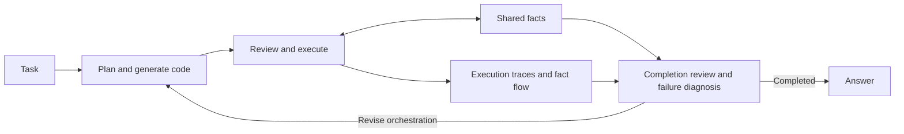

<div align="center">

# COS
### Code as Orchestration: Enabling Efficient Multi-Agent Collaboration with Scripts

**Research code for efficient multi-agent collaboration through executable scripts**

[](pyproject.toml)
[](LICENSE)

[Quick start](#quick-start) · [Reproduction guide](docs/REPRODUCIBILITY.md) · [中文说明](README_zh.md)

</div>

COS represents multi-agent collaboration as executable orchestration programs. A planner generates a program, a runtime executes agent jobs and manages shared facts, and failure diagnosis informs the next orchestration round.

This repository packages the supplied Rolechange V6 implementation. The Python package remains `agent_harness`, and the primary strategy remains `rolechange_self_evolving_v6` for compatibility with the existing code and configurations.

## Overview

- **Executable orchestration:** generated programs express agent roles, job dependencies, and sequential or concurrent execution.
- **Shared fact memory:** evidence maintenance validates and updates reusable facts across jobs and rounds.
- **Failure diagnosis:** fact-flow records and bounded dependency slices guide reflection over execution traces.
- **Iterative improvement:** reflection feeds the next plan-and-code generation round.
- **Evaluation:** a common runner supports baseline strategies, generated orchestration, and V4/V5/V6 variants.



## Quick start

### 1. Clone and build

Use Linux or WSL2 with Bash, Docker, and Docker Compose. The supplied Compose configuration uses host networking; check support on your Docker installation.

```bash
git clone https://github.com/yiranz624/COS.git
cd COS
cp .env.example .env
./scripts/docker-rolechange-v6.sh build
```

The image installs Python 3.12 dependencies from `uv.lock`. A local Python alternative and configuration details are in the [reproduction guide](docs/REPRODUCIBILITY.md).

### 2. Configure services

Edit `.env` with your model endpoint, model IDs, API keys, and the search / retrieval services required by your selected workflow. Keep keys local. The example configuration records the supplied implementation's defaults; available model IDs depend on your provider. If you change models, also update the role assignments in `orchestrations/profiles/deepseek_v4_flash.yaml`, or create a separate profile.

Online runs call external services and can incur API charges. No credentials are bundled.

### 3. Prepare benchmark data

Obtain data from the benchmark's original distributor under its terms, and convert it to the harness schema. BrowseComp, for example, is read from:

```text
benchmarks/datasets/BrowseComp/standardized_data.jsonl
```

See [data preparation](docs/REPRODUCIBILITY.md#data-preparation) for the JSONL fields. Benchmark datasets and historical run outputs are not bundled.

### 4. Run a small evaluation

```bash
./scripts/docker-rolechange-v6.sh run env ROLECHANGE_V6_MODE=slice \
  python -m benchmarks.runner.run_subprocess \
  --benchmark browsecomp \
  --strategy rolechange_self_evolving_v6 \
  --orchestration-profile deepseek_v4_flash \
  --limit 1 --no-shuffle --concurrency 1 \
  --out results/COS-smoke
```

Compose mounts container `results/` to host `results/<user>/`. This is an online smoke run, not a complete reproduction of paper results.

## Ablations and diagnostics

`ROLECHANGE_V6_MODE` selects the diagnostic configuration:

| Mode | Behavior |
| --- | --- |
| `off` | Original reflection retrieval without fact-flow recording |
| `flow_only` | Fact-flow recording with the original reflection retrieval |
| `slice` | Fact-flow recording and slice-first diagnostic retrieval (default) |

```bash
./scripts/docker-rolechange-v6.sh run python scripts/run_v6_ablation.py \
  --out results/COS-ablation
```

The script compares the three modes on its configured question IDs. V6 planner prompts preserve exact fact IDs in all modes, so `off` is not an exact recreation of the V5 prompt configuration. See [reproduction notes](docs/REPRODUCIBILITY.md#ablations-and-run-artifacts).

## Repository layout

| Path | Purpose |
| --- | --- |
| `agent_harness/orchestration/` | Generated code, runtime, shared facts, evolution, flow tracking, diagnostic slices |
| `orchestrations/` | Role profiles and orchestration scripts |
| `benchmarks/` | Dataset registry, evaluation runner, judges, and reporting |
| `workflows/`, `plugins/` | Agent workflows and tools |
| `examples/` | Example orchestration programs |
| `tests/` | Unit and integration-style tests using local test doubles |
| `scripts/` | Docker entry points, evaluation, ablation, and diagnostic replay |
| `docs/` | Reproduction instructions and implementation references |

## Development

```bash
./scripts/docker-rolechange-v6.sh unit
./scripts/docker-rolechange-v6.sh lint
```

The CI workflow builds the Docker environment, lints, runs tests, and checks imports. CI status and online evaluation results should be checked independently; the presence of a workflow is not evidence that all checks pass. Generated orchestration executes Python programs, so use an isolated environment for experiments.

## Reproducibility status

This release includes code, configurations, a dependency lockfile, and run instructions. Full paper scores require the matching data, task split, provider/model versions, budgets, and evaluation settings. No performance table is presented here because those conditions and full results have not been independently verified for this archive. A paper link and formal citation can be added when publication metadata is available.

## Acknowledgements and license

COS builds on the AgentHarness evaluation harness associated with Apodex. The original [Apache 2.0 license](LICENSE) is retained. See [NOTICE](NOTICE) for provenance and release changes. The source implementation references are preserved in `docs/`; older names in those documents describe implementation history.

## Contributors

[ruirui20060208-dot](https://github.com/ruirui20060208-dot) · [yiranz624](https://github.com/yiranz624) · [An-Moon](https://github.com/An-Moon) · [bzda-bit](https://github.com/bzda-bit) · [yinziqiu666](https://github.com/yinziqiu666)
